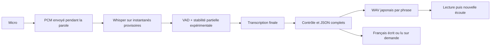

# Laboratoire vocal — diagnostic et migration progressive

28 octobre 2026, après le lot 2 (`31840b0`). Le retour humain est clair : reconnaissance parfois incorrecte et attente ressemblant à une messagerie vocale. Ce retour qualitatif est reçu ; aucun corpus de voix ni bilan chiffré de cet essai n’est encore disponible pour attribuer chaque erreur à sa cause.

**Décision : conserver le vocal classique, ajouter un prototype isolé et ne promouvoir aucun moteur ou seuil sans comparaison humaine.** Le laboratoire ne modifie pas les erreurs, révisions, objectifs ni réussites sauvegardés. La qualité d’un véritable appel et l’objectif médian inférieur à trois secondes restent à démontrer.

## Pourquoi l’échange actuel attend

Le micro démarre après la lecture et sa préparation. Android utilise le preset haute qualité : AAC en conteneur M4A, 44,1 kHz stéréo, 128 kbit/s demandés ; le matériel effectif reste à observer. La capture est arrêtée après 1,8 s sans énergie, avec au moins 300 ms de voix. Ce minimum peut pénaliser une réponse très courte. Le fichier complet est lu puis encodé en base64 avant l’envoi HTTP.

Ensuite seulement, ffmpeg décode en float32 mono 16 kHz. Whisper Small détecte la langue sur cet énoncé, avec un prompt bilingue. Un énoncé court, un accent débutant ou une faute volontaire peuvent être reconnus ou normalisés différemment : hypothèses à vérifier sur le son, pas explications certaines du retour utilisateur. Le filtre d’incertitude n’est pas calibré pour cette voix.

Qwen termine le contrôle grammatical, puis le JSON du dialogue. La synthèse japonaise et la française sont parallèles, mais la réponse HTTP attend leur résultat ou le délai français borné. Le lecteur prononce ensuite l’explication française avant le japonais. Le micro ne reprend qu’à la fin. Chaque étape est fonctionnelle ; leur addition produit une succession de tours complets. Un WebSocket seul ne change ni cette dépendance pédagogique ni le fonctionnement de Whisper.

Sources locales : `src/lib/use-oral-session.ts`, `src/lib/voice-activity.ts`, `src/lib/tutor-playback.ts`, `server/app.ts`, `server/conversation_worker.py`. Les 4,88 s du lot 2 étaient un appel HTTP synthétique sans cache, pas la fin réelle d’une parole humaine jusqu’au premier son japonais.

## Choix d’architecture

| Solution | Ce qui peut commencer plus tôt | Contraintes et coût technique | Décision |
|---|---|---|---|
| Vocal classique actuel | Rien pendant la capture ; moteurs persistants et caches déjà en place | Fichiers, conversion et base64 ; un seul ASR par tour, comportement connu | Repli conservé, inchangé par défaut |
| PCM continu + instantanés Whisper + réponse japonaise segmentée | Transport et reconnaissance pendant la parole ; premier WAV japonais envoyé avant les suivants et sans Vivienne | Capture native et web distinctes, annulation/ordre/pression réseau ; plusieurs ASR par tour et davantage de PCM transmis | Prototype de ce lot, hors progression |
| ASR réellement conçu pour le flux + détection de fin d’énoncé | État acoustique réutilisé, stabilité et fin de tour potentiellement mieux gérées | Autres poids/runtime et calibration japonaise/française sur ce Mac ; bénéfice non mesuré | Comparer après le premier corpus humain |
| Modèle vocal de bout en bout | Compréhension et voix potentiellement intégrées | Compatibilité Mac, coût mémoire, contrôles pédagogiques et mémoire à reconstruire ; pas de solution équivalente validée ici | Pas de refonte engagée |

Ce prototype n’est pas un ASR à état acoustique continu : il retranscrit des instantanés cumulatifs, au plus une inférence à la fois, avec coalescence des demandes et priorité au final. Une longue hésitation augmente donc le travail. Le japonais imposé et l’automatique sont des profils d’essai ; aucun n’est promu comme meilleur. Le mode automatique reste disponible pour les demandes françaises.

PCM16 mono 16 kHz représente **32 000 octets/s**, hors en-têtes. L’AAC demandé à 128 kbit/s représente environ 16 000 octets/s, puis environ 21 333 avec base64. Le PCM progressif économise la compression et l’attente du fichier ; il peut transmettre davantage d’octets. Ce choix est mesuré sur le Wi-Fi local, sans promesse de meilleur débit ou de moindre consommation.

## Expo et plateformes

Le projet installe Expo 58.0.19 et expo-audio 58.0.10. `useAudioStream` fournit les buffers PCM et le taux/canaux réellement émis. Il faut utiliser ces valeurs, pas supposer que le matériel a accepté 16 kHz. Le SDK documente la capture native et les formats [dans son API audio](https://docs.expo.dev/versions/v58.0.0/sdk/audio/) ; son [changelog](https://github.com/expo/expo/blob/main/packages/expo-audio/CHANGELOG.md) inclut le correctif Android des octets de fin de lecture courte.

Le laboratoire demande du PCM signé int16 et remélange/rééchantillonne si nécessaire en conservant sa phase entre buffers. Ce traitement ne restaure pas les fréquences d’un micro limité à 8 kHz. Le module installé utilise un stub sur web : le laboratoire a donc un adaptateur Web Audio distinct. Sur iOS, un repli natif peut modifier l’encodage sans le signaler dans les métadonnées ; la capture expérimentale reste limitée à **Android et web** tant que ce chemin n’est pas validé. Le vocal classique iOS reste disponible. Le module natif est vérifié avant de monter le hook pour éviter un crash avec un ancien Expo Go.

L’export Android ne prouve pas la présence du module dans le binaire Expo Go installé ni la qualité de son micro. Le matériel, Bluetooth, interruptions système et restrictions réseau sont des vérifications humaines. Aucun APK supplémentaire n’est imposé si l’Expo Go compatible fournit le module ; un échec de capacité est affiché plutôt que dissimulé.

## Sécurité du tour et comportement pédagogique

Le serveur active le laboratoire uniquement avec `SENSEI_VOICE_LAB=1`. La connexion existante authentifie un ticket de 30 s à usage unique ; le code personnel n’apparaît jamais dans l’URL WebSocket. Origines web, séquences, identifiants de tours, taille des fragments, débit, durée, clients et buffers sont bornés. Pause, fermeture, changement de tour et erreur réseau invalident les callbacks antérieurs. Le travail d’inférence peut finir après une annulation ; ses résultats n’autorisent aucune lecture.

Les fragments PCM ne sont pas des messages pédagogiques. Un partiel ne produit jamais de correction ou de réussite. Une transcription finale incertaine, tronquée ou illisible ne part pas au professeur. La réponse utilise les protections du lot 2, les mêmes intentions d’aide et le rōmaji commun. Le laboratoire garde seulement un historique éphémère pour poursuivre l’échange ; il ne crédite aucune révision ni compétence.

Le mode expérimental conserve un minimum de 1,8 s, exige une stabilité partielle pour ce minimum et attend davantage lorsqu’il manque cette stabilité ou que l’énoncé paraît inachevé. Les faux départs peuvent encore être coupés : ce sont des hypothèses de fin de tour, pas une compréhension sémantique démontrée. Un contrôle manuel permet de constituer des prises comparables. Le mode automatique évite de devoir terminer manuellement chaque tour lors de l’essai conversationnel.

Qwen peut fournir ses tokens progressivement dans le chemin expérimental. Leur temps d’arrivée est mesuré, mais ils restent retenus jusqu’au JSON complet et au contrôle grammatical. Un champ japonais apparu avant la fin du JSON n’est pas une autorisation de le prononcer. Après validation, le serveur synthétise chaque phrase japonaise et l’envoie sans attendre toutes les phrases suivantes. Les explications françaises restent écrites ou sont lues sur demande. Les métriques distinguent premier token, champ japonais complet, attente de validation, enseignement, première synthèse et émission du premier WAV.

Le **barge-in acoustique reste désactivé** : le micro est fermé pendant la voix de Mochi. Une pause manuelle interrompt la lecture et annule le tour. Sans essai Android de l’écho et de la prise de parole simultanée, activer l’écoute pendant la synthèse risquerait de transcrire Mochi et de créer une boucle.

## Extraits humains et mesures

Les métriques partagées ne contiennent ni PCM, audio, transcription, phrase japonaise, code personnel, URL du serveur ou identité. Le laboratoire conserve un bilan borné en mémoire. Le premier événement du lecteur est mesurable ; ce n’est pas une mesure de la pression acoustique au haut-parleur. La fin détectée par énergie est une approximation. Pour une véritable fin de parole humaine, il faut une borne relevée à l’écoute de l’extrait ; une synchronisation ou un enregistrement de référence est nécessaire pour mesurer aussi le son effectivement émis.

L’option **Garder mes extraits sur le Mac**, désactivée par défaut, conserve volontairement les WAV dans `.local/voice-lab/samples/`. Ces fichiers privés servent uniquement à la comparaison ; ils ne sont jamais inclus dans le bilan numérique ou Git. Le manifeste est créé avec références vides et `humanValidated:false`. Aucun résultat ASR ne remplit automatiquement une référence. [Collecte, références verbatim et comparaison des quatre configurations](VOICE-LAB-HUMAN-CORPUS.md).

Les erreurs sont séparées : transcription (comparaison au verbatim humain), interprétation de l’intention (annotation distincte), puis correction pédagogique (réaction effectivement observée). Le CER ne remplace pas ces deux derniers jugements. Les alternatives `whisper.cpp`, faster-whisper et Qwen3-ASR sont documentées dans le protocole, sans prétendre les avoir installées ou mesurées. Whisper lui-même n’est pas conçu comme un ASR continu ; les politiques de stabilité ajoutent des compromis de latence. [Travail Whisper-Streaming](https://github.com/ufal/whisper_streaming), [exemple officiel whisper.cpp](https://github.com/ggml-org/whisper.cpp/tree/master/examples/stream).

## Essai sur ton Android

1. Sur le Mac, arrêter le serveur Sensei du terminal concerné puis lancer `npm run local:lab`. Garder Expo actif sur le port habituel et les deux appareils sur le même Wi-Fi. Aucun nouveau code personnel.
2. Recharger Sensei dans Expo Go. Réglages → **Ouvrir le laboratoire vocal**. Le bouton de retour ramène au parcours classique.
3. Commencer en reconnaissance seule pour comparer ce qui est réellement entendu : réponse courte, phrase naturelle, hésitation, autocorrection, demande française, puis bruit ordinaire. Les textes provisoires peuvent changer ; ils ne sont pas notés.
4. Pour la comparaison de précision, activer volontairement la conservation des extraits et suivre le protocole de références. Sans cette option, garder le micro uniquement pour l’essai interactif.
5. Activer les réponses de Mochi puis essayer plusieurs minutes sans terminer chaque phrase à la main. Tester pause/reprise, passage bref à une autre app et perte/reprise du Wi-Fi. Une erreur réseau peut nécessiter de reprendre la connexion ; aucune ancienne réponse ne doit être rejouée.
6. Partager le bilan numérique et décrire les mots mal compris, coupures d’hésitation, fausses corrections, répétitions, attente et reprise. Ne pas transmettre d’audio personnel automatiquement.

Le résultat reste **pending-human** tant que cet essai et la validation des références ne sont pas réalisés. Revenir au serveur habituel avec `npm run local:lan` désactive le laboratoire côté serveur ; le parcours classique est conservé.

## Vérifications et recommandation

Les résultats mesurés et les vérifications finales sont consignés dans `VOICE-LAB-RESULTS.md`. Ils séparent essais synthétiques, contrôles de contrats et données humaines absentes. La recommandation avant remplacement est de comparer les mêmes extraits humains, vérifier plusieurs minutes Android et observer les corrections/révisions avant de raccorder ce nouveau chemin à la progression. Ne pas activer le barge-in ni annoncer un délai humain inférieur à trois secondes sur la seule base d’un benchmark local.
